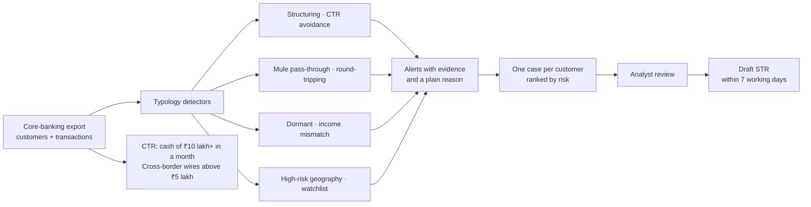

# MoneyTrail


**Anti-money-laundering transaction monitoring for Indian NBFCs, small finance and cooperative banks, and payment companies: alerts that explain themselves, one ranked case per customer, and the FIU-IND reports drafted.**

Every reporting entity under PMLA must monitor transactions, file a Suspicious Transaction Report (STR) with FIU-IND within 7 working days of concluding something is suspicious, and send Cash Transaction Reports and Cross-Border Wire Transfer Reports every month. Most small institutions do this with threshold rules ("flag anything over ₹1 lakh"). Analysts drown in alerts about salaries and home purchases, while real patterns, such as mule accounts passing money through in hours, cash split to stay under limits, or funds going round in a circle, never cross a single threshold. MoneyTrail looks for the patterns instead.

## Results

`python -m moneytrail.evaluate` simulates six months for 2,500 customers (about 420,000 transactions). Most are honest, and plenty look alarming to threshold rules: salaries above ₹1 lakh a month, home purchases by RTGS, shops paid by dozens of UPI customers a day, exporters wiring money abroad. A known set of customers follow laundering typologies. The **held-out** book has stealthier versions (smaller structuring, slower mule flows, four-party circles, other name spellings), was fixed before any detector was written, and was run once.

| dev / held-out | Alerts to review | Customers flagged | Suspicious caught | Honest customers flagged | Real cases in the top 50 |
|---|---|---|---|---|---|
| Threshold rules (what this repo used to do) | 35,143 / 35,367 | 1,878 / 1,857 | 49/52 / 44/47 | 1,829 / 1,813 | 3 / 2 |
| **MoneyTrail** | **128 / 96** | **80 / 59** | **52/52 / 44/47** | **28 / 15** | **46 / 44** |

Threshold rules only "catch" suspicious customers by flagging three quarters of the book. MoneyTrail catches the same or more, **each with the right reason**, with about 1/300th of the alerts. 65% (dev) and 75% (held-out) of the customers it flags are real cases, against 2 to 3% for threshold rules. An analyst who opens the top 50 cases finds 46 and 44 real ones, against 3 and 2.

| Typology (red flag) | Dev: caught for the right reason | Held-out |
|---|---|---|
| Structuring: several cash deposits just under ₹50,000 (the PAN limit) | 8/8 | 7/7 |
| CTR avoidance: a month of cash just under ₹10 lakh, unusual for the customer | 5/5 | 3/4 |
| Mule account: many senders in, most of it out to a few accounts within hours | 10/10 | 9/9 |
| Round-tripping: funds going round A → B → C (→ D) → A | 9/9 | 8/8 |
| Dormant account suddenly receiving large sums | 5/5 | 4/4 |
| Credits far above declared income (individuals) | 6/6 | 6/6 |
| Transfers with FATF high-risk jurisdictions | 4/4 | 3/3 |
| Counterparty on a watchlist (spelling variants, initials, word order) | 5/5 | 4/6 |

Watchlist matching made 0 false matches in both sets, rejecting close look-alikes such as "Mohammed Arif Kha**nna**" and "Rajesh Kumar Tr**ipathi**". The two held-out misses ("Mohamad", "Powar") are spellings outside its alias table; a deployment loads a fuller transliteration list.

### How the benchmark kept me honest

| Round | Finding | Fix |
|---|---|---|
| 1 | 249 honest customers flagged: shops that deposit ₹9 lakh of cash every month, retirees whose fixed deposits matured | Near-limit cash must be at least 3x the customer's usual month; own-account transfers (FD maturity) are not income; shop and business turnover is not personal income |
| 1 | A salaried mule was missed because his ordinary UPI spending made "few receivers" false | Look at whether the top 3 receivers took most of the money |
| 1 | Watchlist matched "Mohammed Arif Khanna" to "Mohammed Arif Khan" | Name matching by token: every listed name part must be present (initials allowed), no fuzzy whole-string scores |
| 1 | Some aliases had been added with the held-out spellings in mind | Removed before the held-out run; the two resulting misses are reported above |

## Who buys it and how it is sold

| | |
|---|---|
| **Buyers** | NBFCs and microfinance lenders, small finance and cooperative banks, payment aggregators and prepaid wallet issuers, fintech lenders, virtual digital asset service providers registered with FIU-IND |
| **Their pain** | Threshold rules bury 2 to 3 analysts in alerts; real mule and structuring patterns slip through; STRs take hours to write; RBI and FIU-IND inspections ask why an alert was closed |
| **What they get** | Pattern-based alerts with the exact transactions and a plain reason, one ranked case per customer, a CTR and cross-border report file, and a draft STR for the reviewing officer |
| **Deployment** | Docker inside the client's network; reads core-banking CSV or Excel exports; no customer data leaves |
| **Control** | Thresholds in code are reviewable and versioned; every alert carries its evidence; the final decision and the STR stay with the principal officer |

**ROI example** (illustrative): at the alert volumes above, an analyst clearing 60 alerts a day needs 585 days for six months of threshold-rule alerts and about 2 days for MoneyTrail's. Even if real-world precision is a third of the benchmark, a two-person AML team can review every case properly instead of sampling, and missed-STR risk falls with it.

| Plan (suggested) | For | Price idea |
|---|---|---|
| Starter | Up to 50,000 accounts | Monthly fee, monthly batch scan, CTR and cross-border reports |
| Growth | Up to 5 lakh accounts | Daily scans, case queue for the team, STR drafts |
| Enterprise | Larger institutions | Annual licence, on-premise, custom typologies, model-risk documentation |

**Pilot plan (4 weeks):** run MoneyTrail on the client's last 6 months of transactions next to their current system. Compare alert volumes, the cases each found, and the STRs they actually filed. The client sees the workload change and any patterns their rules missed, on their own data, before switching.

## How it works



| Design choice | Why |
|---|---|
| Patterns, not single thresholds | Launderers stay under thresholds; honest customers cross them every day |
| Compare a customer with their own history | ₹9 lakh of cash is normal for a busy shop and alarming for a salaried employee |
| Every alert lists its transactions | An analyst can confirm or close it in minutes, and an inspector can see why |
| One case per customer, ranked | Analysts start with the riskiest customer, not the oldest alert |
| Draft STR, never auto-filed | Under PMLA the decision belongs to the principal officer; the draft saves the writing |
| Watchlist by name parts | "Mohd. Arif Khan" must match; "Mohammed Arif Khanna" must not |

## Use it

```bash
pip install -e ".[app]" && streamlit run app.py              # dashboard on a sample book
pip install -e .
moneytrail demo --out demo                                    # sample customers.csv + transactions.csv
moneytrail scan demo/customers.csv demo/transactions.csv --out cases.xlsx
python -m moneytrail.evaluate                                 # benchmark
docker compose up -d                                          # API :8000 + dashboard :8501
```

`cases.xlsx` holds the ranked case queue, every alert with its transactions, the CTR rows with due dates, cross-border wires above ₹5 lakh, and a draft STR for the top case.

| Endpoint | What it does |
|---|---|
| `POST /v1/scan` | Upload `customers`, `transactions` (CSV) and optional `watchlist` (one name per line); returns ranked cases |
| `GET /v1/scan/{id}/str/{customer_id}` | Draft STR narrative for one case |
| `GET /v1/scan/{id}/ctr` | Cash Transaction Report rows with due dates |

## Limitations

- The benchmark is synthetic: real laundering data cannot be published with ground truth. The pilot measures it on real transactions and real STRs.
- Rules are explainable and auditable but not learned; typologies outside the eight covered (trade-based laundering, layering through many hops) need new detectors.
- The FATF high-risk list and the watchlist are examples; production must load the current FATF statements, UN and domestic sanctions lists, and a fuller transliteration table.
- It assists the AML team; it is not legal advice and does not file anything with FIU-IND.

## Project layout

```
src/moneytrail/detect.py    eight typology detectors, name matching, rules in one place
src/moneytrail/cases.py     cases ranked by risk, CTR, cross-border report, draft STR
src/moneytrail/io.py        core-banking CSV / Excel import with column mapping
src/moneytrail/synth.py     six-month book with planted typologies (dev + held-out)
src/moneytrail/evaluate.py  benchmark vs threshold rules, CI gate
src/moneytrail/api.py       FastAPI service
app.py                      Streamlit case queue and reports
```
